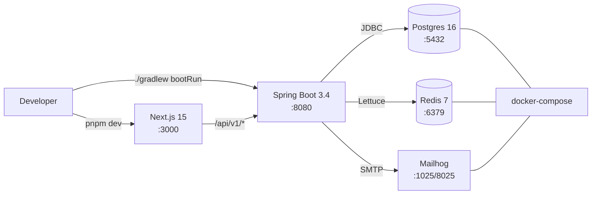

# Phase 01 — Setup Environment & Project Scaffolding

## Context Links
- Parent plan: [plan.md](./plan.md)
- Decisions: [decisions-log.md](./decisions-log.md)
- Research: [researcher-02-learning-algos-and-infra.md](./research/researcher-02-learning-algos-and-infra.md) (§D Spring Boot layout, §E Testcontainers)
- Docs: [Spring Boot 3.4](https://docs.spring.io/spring-boot/docs/3.4.x/reference/), [Next.js 15](https://nextjs.org/docs), [shadcn/ui init](https://ui.shadcn.com/docs/installation/next)
- Next phase: [phase-02-database-schema.md](./phase-02-database-schema.md)

## Overview
- **Date:** 2026-05-09
- **Priority:** P1 (blocks all phases)
- **Status:** pending
- **Effort:** 6h
- **Description:** Bootstrap monorepo with `backend/` (Spring Boot 3.4, Gradle Kotlin DSL, Java 21) and `frontend/` (Next.js 15, TS, Tailwind, shadcn/ui). Stand up `docker-compose.yml` (postgres+redis+mailhog). Wire CI (GitHub Actions). Establish profiles, lint, format, baseline `application.yml`.

## Key Insights
- Single Gradle module + package-by-feature scales well to MVP team size.
- `@ServiceConnection` (Spring Boot 3.1+) removes property-string config in tests.
- Next.js 15 App Router default; `pnpm` chosen for fast install + lockfile fidelity.
- Mailhog catches SMTP locally on `:1025` (SMTP) / `:8025` (UI).

## Requirements
**Functional**
- `docker compose up -d` starts postgres+redis+mailhog with named volumes.
- `./gradlew bootRun` boots Spring Boot on `:8080`, hits `/actuator/health` returning UP.
- `pnpm dev` boots Next.js on `:3000`, root page renders Tailwind-styled placeholder.
- `./gradlew check` runs unit tests + spotless/checkstyle (or skip lint if too noisy — KISS).
- `pnpm lint && pnpm build` succeeds.

**Non-functional**
- BE Java 21, Gradle 8.10+, Spring Boot 3.4.x.
- FE Node 20 LTS, pnpm 9, Next.js 15, React 19, Tailwind 3.4.
- All scripts cross-platform (bash + powershell hints in README).
- Repo root has `.editorconfig`, `.gitignore`, `README.md` skeleton.

## Architecture

## Related Code Files
**Create**
- `/README.md` — project intro, prereqs, how-to-run.
- `/.editorconfig`, `/.gitignore`.
- `/docker-compose.yml` — postgres, redis, mailhog, named volumes.
- `/.github/workflows/ci.yml` — backend + frontend matrix.
- `/backend/build.gradle.kts` — deps + plugins.
- `/backend/settings.gradle.kts` — root project name.
- `/backend/gradle/wrapper/*` — wrapper.
- `/backend/src/main/java/com/engly/EnglyApplication.java` — `@SpringBootApplication`.
- `/backend/src/main/resources/application.yml` — base config + profile activation.
- `/backend/src/main/resources/application-dev.yml` — dev DS+Redis localhost.
- `/backend/src/main/resources/application-test.yml` — test profile.
- `/backend/src/main/resources/application-prod.yml` — prod placeholders, `ddl-auto=validate`.
- `/backend/src/main/resources/logback-spring.xml` — JSON encoder.
- `/backend/src/test/java/com/engly/AbstractIntegrationTest.java` — Testcontainers base.
- `/frontend/package.json`, `/frontend/tsconfig.json`, `/frontend/next.config.mjs`.
- `/frontend/tailwind.config.ts`, `/frontend/postcss.config.mjs`, `/frontend/src/app/globals.css`.
- `/frontend/src/app/layout.tsx`, `/frontend/src/app/page.tsx` — placeholder.
- `/frontend/components.json` — shadcn/ui config.
- `/frontend/.eslintrc.json`, `/frontend/.prettierrc`.

## Implementation Steps
1. `mkdir -p engly/{backend,frontend,docs}` from repo root (already at `/Users/admin/Desktop/DEV/AI/Engly`).
2. Create root `README.md` with title, 3-section TOC (Stack, Run, Structure).
3. Create `.gitignore` (Node, Gradle, Java, IDE, env). Create `.editorconfig`.
4. Author `docker-compose.yml`:
   - `postgres:16-alpine` — env `POSTGRES_DB=engly_dev`, `POSTGRES_USER=engly`, `POSTGRES_PASSWORD=engly`, port `5432:5432`, volume `pg_data`.
   - `redis:7-alpine` — port `6379:6379`, volume `redis_data`.
   - `mailhog/mailhog:latest` — ports `1025:1025`, `8025:8025`.
5. Generate BE via Spring Initializr equivalent (manual file creation): plugins `java`, `org.springframework.boot:3.4.0`, `io.spring.dependency-management:1.1.6`. Java 21.
6. Add BE deps in `build.gradle.kts`: spring-boot-starter-{web,data-jpa,data-redis,validation,actuator,mail}, oauth2-{resource-server,client}, flyway-core, postgresql (runtime), lombok (compile+ap), mapstruct + processor, jjwt-{api,impl,jackson} 0.12.6, springdoc-openapi-starter-webmvc-ui 2.6.0, bucket4j-spring-boot-starter (or bucket4j-redis 8.x), logstash-logback-encoder. Test: spring-boot-starter-test, testcontainers (postgres, junit-jupiter), spring-boot-testcontainers.
7. Create `EnglyApplication.java` with `@SpringBootApplication`.
8. Create `application.yml` (base): `spring.application.name=engly`, `spring.profiles.active=${SPRING_PROFILES_ACTIVE:dev}`, `server.port=8080`, `springdoc.swagger-ui.path=/swagger-ui.html`.
9. Create `application-dev.yml`: datasource jdbc URL `jdbc:postgresql://localhost:5432/engly_dev`, redis host `localhost`, mail host `localhost` port `1025`, `spring.jpa.hibernate.ddl-auto=validate` (Flyway owns schema), `spring.flyway.enabled=true`.
10. Create `application-test.yml`: empty (Testcontainers `@ServiceConnection` injects).
11. Create `application-prod.yml`: env-driven `${DB_URL}`, `${DB_USER}`, `${DB_PASSWORD}`, `${REDIS_URL}`, `ddl-auto=validate`.
12. Create `logback-spring.xml` w/ console JSON encoder for non-dev profiles, plain pattern for dev.
13. Create `AbstractIntegrationTest.java` w/ static `PostgreSQLContainer<>("postgres:16-alpine")` + `GenericContainer<>("redis:7-alpine").withExposedPorts(6379)` annotated `@ServiceConnection`.
14. Add `~/.testcontainers.properties` doc note in README (`testcontainers.reuse.enable=true`).
15. Run `./gradlew bootRun` once → verify `/actuator/health` UP, `/swagger-ui.html` reachable.
16. Generate FE: `pnpm dlx create-next-app@latest frontend --ts --tailwind --eslint --app --src-dir --import-alias "@/*"`.
17. Init shadcn/ui: `pnpm dlx shadcn@latest init` (Slate, CSS variables, base color = neutral).
18. Add `next-themes`, `@tanstack/react-query`, `@tanstack/react-query-devtools`, `next-auth@beta` (v5), `react-hook-form`, `zod`, `@hookform/resolvers`, `axios` (or keep `fetch`), `react-calendar-heatmap`, `lucide-react`, `clsx`, `class-variance-authority`.
19. Configure Prettier (`.prettierrc`: 2-space, single quotes, trailing comma `all`). ESLint: extend `next/core-web-vitals` + `next/typescript`.
20. Create root layout w/ `next-themes` provider + TanStack QueryClientProvider (client component wrapper).
21. Stub `/frontend/src/app/page.tsx` w/ shadcn `Button` to confirm install.
22. Author `.github/workflows/ci.yml` — two jobs: `backend` (setup-java@v4 java 21 + gradle/gradle-build-action + `./gradlew check`) and `frontend` (setup-node@v4 node 20 + pnpm/action-setup + `pnpm install --frozen-lockfile && pnpm lint && pnpm build`). Trigger on PR + main push.
23. Smoke test: `docker compose up -d`, `./gradlew bootRun` (BE up), `pnpm dev` (FE up). Hit `http://localhost:3000` and `http://localhost:8080/actuator/health`.
24. Commit: `chore: bootstrap monorepo with backend, frontend, docker-compose, CI`.

## Todo List
- [ ] Repo root files (README, .gitignore, .editorconfig)
- [ ] docker-compose.yml (postgres+redis+mailhog)
- [ ] Backend Gradle scaffold w/ all deps
- [ ] EnglyApplication.java + application.yml profiles
- [ ] logback-spring.xml JSON encoder
- [ ] AbstractIntegrationTest base class
- [ ] Frontend Next.js scaffold via create-next-app
- [ ] Tailwind + shadcn/ui init
- [ ] Auth/Query/Theme deps installed
- [ ] ESLint + Prettier configured
- [ ] Layout + placeholder page
- [ ] GitHub Actions ci.yml
- [ ] Smoke test BE+FE+DB+Redis up locally

## Success Criteria
- `docker compose up -d` → all 3 services healthy.
- `./gradlew check` passes (no tests yet, just compile + Spotless if added).
- `pnpm lint && pnpm build` passes on a clean clone.
- CI matrix green on PR.
- README how-to-run is followable by a fresh dev in <10 min.

## Risk Assessment
- **Risk:** pnpm vs npm divergence on lockfiles → **Mitigation:** commit `pnpm-lock.yaml`, document `corepack enable`.
- **Risk:** Java 21 not installed on dev machines → **Mitigation:** README points to SDKMAN; add `.sdkmanrc`.
- **Risk:** Gradle wrapper out-of-date breaking CI → **Mitigation:** pin Gradle 8.10 in wrapper-properties.
- **Risk:** shadcn `init` overwrites layout → **Mitigation:** run before adding custom layout code.

## Security Considerations
- No secrets in repo. `.env.example` for both BE and FE; `.env` git-ignored.
- Default Postgres password `engly` is dev-only; production uses env-injected secret.
- CORS allowlist `http://localhost:3000` in dev; `application-prod.yml` reads `CORS_ALLOWED_ORIGINS`.

## Next Steps
Proceed to [phase-02-database-schema.md](./phase-02-database-schema.md) — define Flyway migrations + JPA entities skeleton.
