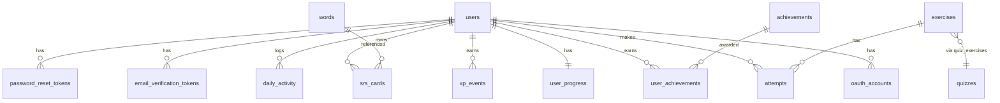

# Phase 02 — Database Schema & Flyway Migrations

## Context Links
- Parent: [plan.md](./plan.md)
- Prev: [phase-01-setup-environment.md](./phase-01-setup-environment.md)
- Next: [phase-03-authentication.md](./phase-03-authentication.md)
- Research: [researcher-02-learning-algos-and-infra.md](./research/researcher-02-learning-algos-and-infra.md) (§A SM-2 fields, §C streak schema)
- Docs: [Flyway naming](https://documentation.red-gate.com/fd/migrations-184127470.html), [Postgres 16 indexes](https://www.postgresql.org/docs/16/indexes.html)

## Overview
- **Date:** 2026-05-09
- **Priority:** P1
- **Status:** pending
- **Effort:** 8h
- **Description:** Define entire MVP relational schema across 8 versioned Flyway migrations. JPA entities are stubbed (no business logic yet) so feature phases can flesh out repos+services.

## Key Insights
- Use `UUID` PKs (`gen_random_uuid()` via `pgcrypto` extension) for FE-safe IDs.
- `JSONB` for flexible-shape columns: word definitions, exercise options.
- Index hot-path queries: `srs_cards (user_id, next_review_date)`, `attempts (user_id, exercise_id)`, `xp_events (user_id, created_at desc)`.
- `created_at`, `updated_at` audited via JPA `@CreatedDate`, `@LastModifiedDate` (`@EntityListeners(AuditingEntityListener.class)` + `@EnableJpaAuditing`).
- Refresh tokens NOT in Postgres (Redis-only per decisions log).

## Requirements
**Functional**
- 14 tables created across 8 migration files (logical grouping).
- Reverse-deletion order respected (FK cascades where ownership; restrict elsewhere).
- All FKs indexed.
- Seed migration adds 50 starter words + 30 grammar exercises (V8).

**Non-functional**
- Migration files immutable once committed (forward-only). Reformatting forbidden — checksums break.
- Naming: `V{N}__{snake_case_description}.sql`.
- All timestamps `TIMESTAMPTZ` (UTC).

## Architecture (ER overview)


## Related Code Files
**Create — migrations**
- `V1__enable_extensions_and_users.sql`
- `V2__oauth_and_auth_tokens.sql`
- `V3__words_and_srs_cards.sql`
- `V4__grammar_exercises_quizzes_attempts.sql`
- `V5__user_progress_streak.sql`
- `V6__xp_events_and_daily_activity.sql`
- `V7__achievements_and_user_achievements.sql`
- `V8__seed_words_and_exercises.sql`

**Create — JPA entities (stubs, full bodies in feature phases)**
- `auth/User.java`, `auth/OAuthAccount.java`, `auth/EmailVerificationToken.java`, `auth/PasswordResetToken.java`
- `vocabulary/Word.java`, `vocabulary/SrsCard.java`
- `grammar/Exercise.java`, `grammar/Quiz.java`, `grammar/QuizExercise.java`, `grammar/Attempt.java`
- `gamification/UserProgress.java`, `gamification/XpEvent.java`, `gamification/Achievement.java`, `gamification/UserAchievement.java`, `gamification/DailyActivity.java`
- `common/config/JpaAuditingConfig.java` (`@EnableJpaAuditing`)
- `common/audit/Auditable.java` (mapped superclass w/ created_at, updated_at)

## Implementation Steps

### V1 — extensions + users
```sql
CREATE EXTENSION IF NOT EXISTS pgcrypto;

CREATE TABLE users (
  id UUID PRIMARY KEY DEFAULT gen_random_uuid(),
  email VARCHAR(255) NOT NULL UNIQUE,
  password_hash VARCHAR(255), -- nullable: OAuth-only users
  display_name VARCHAR(80) NOT NULL,
  avatar_url VARCHAR(500),
  cefr_self_rating VARCHAR(2), -- A1..C2
  timezone VARCHAR(64) NOT NULL DEFAULT 'UTC',
  daily_goal_xp INT NOT NULL DEFAULT 50,
  email_verified BOOLEAN NOT NULL DEFAULT FALSE,
  role VARCHAR(20) NOT NULL DEFAULT 'USER' CHECK (role IN ('USER','ADMIN')),
  enabled BOOLEAN NOT NULL DEFAULT TRUE,
  created_at TIMESTAMPTZ NOT NULL DEFAULT NOW(),
  updated_at TIMESTAMPTZ NOT NULL DEFAULT NOW()
);
CREATE INDEX idx_users_email_lower ON users (LOWER(email));
```

### V2 — oauth + email/reset tokens
```sql
CREATE TABLE oauth_accounts (
  id UUID PRIMARY KEY DEFAULT gen_random_uuid(),
  user_id UUID NOT NULL REFERENCES users(id) ON DELETE CASCADE,
  provider VARCHAR(20) NOT NULL CHECK (provider IN ('GOOGLE','GITHUB')),
  provider_user_id VARCHAR(255) NOT NULL,
  created_at TIMESTAMPTZ NOT NULL DEFAULT NOW(),
  UNIQUE (provider, provider_user_id)
);
CREATE INDEX idx_oauth_user ON oauth_accounts (user_id);

CREATE TABLE email_verification_tokens (
  id UUID PRIMARY KEY DEFAULT gen_random_uuid(),
  user_id UUID NOT NULL REFERENCES users(id) ON DELETE CASCADE,
  token_hash VARCHAR(64) NOT NULL UNIQUE, -- sha256 hex
  expires_at TIMESTAMPTZ NOT NULL,
  used_at TIMESTAMPTZ,
  created_at TIMESTAMPTZ NOT NULL DEFAULT NOW()
);
CREATE INDEX idx_evt_user ON email_verification_tokens (user_id);

CREATE TABLE password_reset_tokens (
  id UUID PRIMARY KEY DEFAULT gen_random_uuid(),
  user_id UUID NOT NULL REFERENCES users(id) ON DELETE CASCADE,
  token_hash VARCHAR(64) NOT NULL UNIQUE,
  expires_at TIMESTAMPTZ NOT NULL,
  used_at TIMESTAMPTZ,
  created_at TIMESTAMPTZ NOT NULL DEFAULT NOW()
);
CREATE INDEX idx_prt_user ON password_reset_tokens (user_id);
```
*Note: even though research recommends pure-JWT for verify/reset, having a token table enables one-time-use enforcement w/o Redis dependency. Decision logged: keep DB tokens for these, Redis only for refresh.*

### V3 — words + srs_cards
```sql
CREATE TABLE words (
  id UUID PRIMARY KEY DEFAULT gen_random_uuid(),
  text VARCHAR(80) NOT NULL UNIQUE,
  ipa VARCHAR(80),
  part_of_speech VARCHAR(20),
  definitions JSONB NOT NULL DEFAULT '[]'::jsonb, -- [{lang:"en", text:"..."}]
  examples JSONB NOT NULL DEFAULT '[]'::jsonb,    -- [{text:"...", translation:"..."}]
  audio_url VARCHAR(500),
  cefr VARCHAR(2) NOT NULL CHECK (cefr IN ('A1','A2','B1','B2','C1','C2')),
  tags JSONB NOT NULL DEFAULT '[]'::jsonb,        -- ["travel","food"]
  created_at TIMESTAMPTZ NOT NULL DEFAULT NOW(),
  updated_at TIMESTAMPTZ NOT NULL DEFAULT NOW()
);
CREATE INDEX idx_words_cefr ON words (cefr);

CREATE TABLE srs_cards (
  id UUID PRIMARY KEY DEFAULT gen_random_uuid(),
  user_id UUID NOT NULL REFERENCES users(id) ON DELETE CASCADE,
  word_id UUID NOT NULL REFERENCES words(id) ON DELETE RESTRICT,
  state VARCHAR(20) NOT NULL DEFAULT 'NEW' CHECK (state IN ('NEW','LEARNING','REVIEW','RELEARNING')),
  ease_factor DOUBLE PRECISION NOT NULL DEFAULT 2.5,
  interval_days INT NOT NULL DEFAULT 0,
  repetitions INT NOT NULL DEFAULT 0,
  lapses INT NOT NULL DEFAULT 0,
  next_review_date TIMESTAMPTZ NOT NULL DEFAULT NOW(),
  last_reviewed_at TIMESTAMPTZ,
  version INT NOT NULL DEFAULT 0, -- optimistic lock
  created_at TIMESTAMPTZ NOT NULL DEFAULT NOW(),
  updated_at TIMESTAMPTZ NOT NULL DEFAULT NOW(),
  UNIQUE (user_id, word_id)
);
CREATE INDEX idx_srs_user_due ON srs_cards (user_id, next_review_date);
CREATE INDEX idx_srs_user_state ON srs_cards (user_id, state);
```

### V4 — grammar
```sql
CREATE TABLE exercises (
  id UUID PRIMARY KEY DEFAULT gen_random_uuid(),
  type VARCHAR(30) NOT NULL CHECK (type IN ('MULTIPLE_CHOICE','FILL_IN_BLANK','SENTENCE_CONSTRUCTION')),
  topic VARCHAR(60) NOT NULL,
  difficulty VARCHAR(2) NOT NULL CHECK (difficulty IN ('A1','A2','B1','B2','C1','C2')),
  question TEXT NOT NULL,
  options JSONB NOT NULL DEFAULT '[]'::jsonb, -- ["a","b","c","d"] or [] for fill_in
  correct_answer TEXT NOT NULL,                -- canonical form (string or json)
  explanation TEXT,
  created_at TIMESTAMPTZ NOT NULL DEFAULT NOW(),
  updated_at TIMESTAMPTZ NOT NULL DEFAULT NOW()
);
CREATE INDEX idx_exercises_topic ON exercises (topic);
CREATE INDEX idx_exercises_difficulty ON exercises (difficulty);

CREATE TABLE quizzes (
  id UUID PRIMARY KEY DEFAULT gen_random_uuid(),
  title VARCHAR(160) NOT NULL,
  topic VARCHAR(60) NOT NULL,
  difficulty VARCHAR(2) NOT NULL,
  description TEXT,
  created_at TIMESTAMPTZ NOT NULL DEFAULT NOW(),
  updated_at TIMESTAMPTZ NOT NULL DEFAULT NOW()
);

CREATE TABLE quiz_exercises (
  quiz_id UUID NOT NULL REFERENCES quizzes(id) ON DELETE CASCADE,
  exercise_id UUID NOT NULL REFERENCES exercises(id) ON DELETE RESTRICT,
  ordering INT NOT NULL,
  PRIMARY KEY (quiz_id, exercise_id)
);
CREATE INDEX idx_qe_quiz_ord ON quiz_exercises (quiz_id, ordering);

CREATE TABLE attempts (
  id UUID PRIMARY KEY DEFAULT gen_random_uuid(),
  user_id UUID NOT NULL REFERENCES users(id) ON DELETE CASCADE,
  exercise_id UUID NOT NULL REFERENCES exercises(id) ON DELETE RESTRICT,
  quiz_id UUID REFERENCES quizzes(id) ON DELETE SET NULL,
  user_answer TEXT NOT NULL,
  is_correct BOOLEAN NOT NULL,
  time_taken_ms INT,
  created_at TIMESTAMPTZ NOT NULL DEFAULT NOW()
);
CREATE INDEX idx_attempts_user_created ON attempts (user_id, created_at DESC);
CREATE INDEX idx_attempts_user_exercise ON attempts (user_id, exercise_id);
```

### V5 — user_progress (streak)
```sql
CREATE TABLE user_progress (
  user_id UUID PRIMARY KEY REFERENCES users(id) ON DELETE CASCADE,
  current_streak INT NOT NULL DEFAULT 0,
  longest_streak INT NOT NULL DEFAULT 0,
  last_activity_date DATE,                      -- date in user TZ
  total_xp BIGINT NOT NULL DEFAULT 0,
  level INT NOT NULL DEFAULT 1,
  version INT NOT NULL DEFAULT 0,
  updated_at TIMESTAMPTZ NOT NULL DEFAULT NOW()
);
```

### V6 — xp_events + daily_activity
```sql
CREATE TABLE xp_events (
  id UUID PRIMARY KEY DEFAULT gen_random_uuid(),
  user_id UUID NOT NULL REFERENCES users(id) ON DELETE CASCADE,
  source VARCHAR(40) NOT NULL, -- VOCAB_REVIEW, QUIZ_CORRECT, DAILY_GOAL
  amount INT NOT NULL,
  ref_id UUID,                  -- optional source ref (card_id, attempt_id)
  created_at TIMESTAMPTZ NOT NULL DEFAULT NOW()
);
CREATE INDEX idx_xp_user_created ON xp_events (user_id, created_at DESC);

CREATE TABLE daily_activity (
  user_id UUID NOT NULL REFERENCES users(id) ON DELETE CASCADE,
  activity_date DATE NOT NULL,    -- date in user TZ
  reviews_done INT NOT NULL DEFAULT 0,
  quizzes_done INT NOT NULL DEFAULT 0,
  xp_earned INT NOT NULL DEFAULT 0,
  goal_met BOOLEAN NOT NULL DEFAULT FALSE,
  PRIMARY KEY (user_id, activity_date)
);
CREATE INDEX idx_daily_activity_user_date ON daily_activity (user_id, activity_date DESC);
```

### V7 — achievements
```sql
CREATE TABLE achievements (
  code VARCHAR(50) PRIMARY KEY,
  name VARCHAR(120) NOT NULL,
  description TEXT NOT NULL,
  icon VARCHAR(120),
  threshold INT
);

CREATE TABLE user_achievements (
  user_id UUID NOT NULL REFERENCES users(id) ON DELETE CASCADE,
  achievement_code VARCHAR(50) NOT NULL REFERENCES achievements(code) ON DELETE RESTRICT,
  unlocked_at TIMESTAMPTZ NOT NULL DEFAULT NOW(),
  PRIMARY KEY (user_id, achievement_code)
);

INSERT INTO achievements (code, name, description, threshold) VALUES
  ('STREAK_7', 'Week Warrior', '7-day streak', 7),
  ('WORDS_100', 'Centurion', 'Learn 100 words (state=REVIEW)', 100),
  ('PERFECT_QUIZ', 'Bullseye', 'Get 100% on any quiz', 1),
  ('XP_1000', 'Climber', 'Earn 1,000 lifetime XP', 1000);
```

### V8 — seed words + exercises
- 50 A1–A2 starter words (text, ipa, definitions JSONB, cefr).
- 30 grammar exercises across 5 topics: tenses, articles, prepositions, conditionals, modals.
- Idempotent: use `INSERT ... ON CONFLICT (text) DO NOTHING` for words; `ON CONFLICT (id) DO NOTHING` only safe if static UUIDs — better: use `WHERE NOT EXISTS (SELECT 1 FROM exercises WHERE question = ?)`.

### Java entity stubs (one example shown; rest follow pattern)
```java
// auth/User.java
@Entity @Table(name = "users")
@Getter @Setter @NoArgsConstructor
public class User extends Auditable {
  @Id @GeneratedValue private UUID id;
  @Column(nullable = false, unique = true) private String email;
  private String passwordHash;
  @Column(nullable = false) private String displayName;
  // ... timezone, role, enabled, emailVerified, dailyGoalXp ...
}
```

Implementation steps:
1. Author V1..V7 SQL files exactly as above; apply `./gradlew flywayMigrate` against dev DB to verify.
2. Author seed file V8 with `INSERT` statements.
3. Create `Auditable.java` mapped superclass + `JpaAuditingConfig.java`.
4. Create entity classes (one per table) in feature packages; `@Version` on `srs_cards` and `user_progress`.
5. Run `./gradlew bootRun` → Hibernate validates all entities match schema.
6. Verify `psql` access: `psql -h localhost -U engly -d engly_dev -c "\dt"` lists 14 tables.

## Todo List
- [ ] V1 enable_extensions_and_users
- [ ] V2 oauth_and_auth_tokens
- [ ] V3 words_and_srs_cards
- [ ] V4 grammar_exercises_quizzes_attempts
- [ ] V5 user_progress_streak
- [ ] V6 xp_events_and_daily_activity
- [ ] V7 achievements_and_user_achievements
- [ ] V8 seed_words_and_exercises (50+30)
- [ ] Auditable mapped superclass + JpaAuditingConfig
- [ ] All 14 entity stubs created
- [ ] Hibernate `validate` mode passes

## Success Criteria
- `./gradlew bootRun` boots clean (Hibernate `validate` passes).
- 14 tables present in dev DB.
- Seed query returns ≥50 words, ≥30 exercises, 4 achievements.
- All FKs indexed (verify via `\d+ <table>`).

## Risk Assessment
- **Risk:** Migration drift across devs → **Mitigation:** never edit committed migration; new file for change.
- **Risk:** Optimistic lock missed on hot rows → **Mitigation:** `@Version` on `srs_cards`, `user_progress`; integration test to assert.
- **Risk:** JSONB query performance → **Mitigation:** OK for MVP read sizes; document GIN index path if needed.

## Security Considerations
- `password_hash` nullable for OAuth-only users (must enforce: at least one of password_hash OR oauth_accounts row).
- Email lower-case-indexed for case-insensitive lookup.
- No PII in token tables (only `token_hash` SHA-256, never plaintext).
- `ON DELETE CASCADE` from `users` propagates → ensure GDPR delete-user covers all tables.

## Next Steps
[phase-03-authentication.md](./phase-03-authentication.md) — implement auth using these tables.
