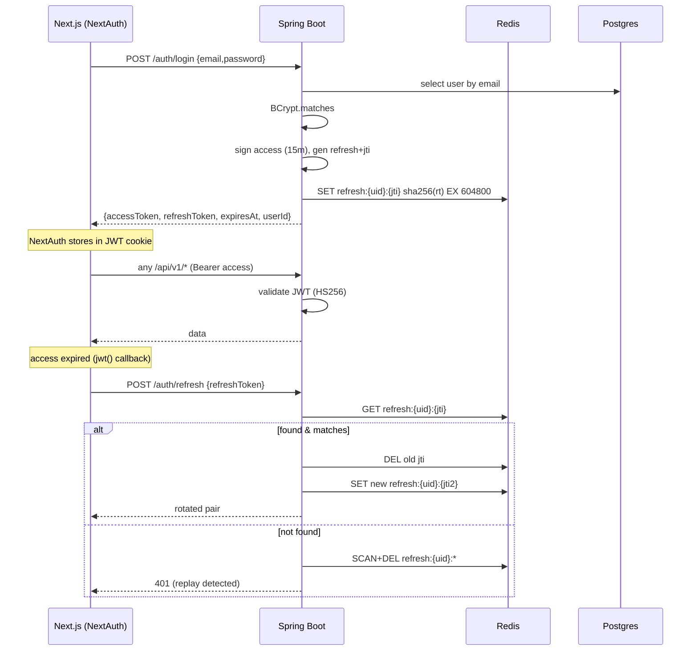
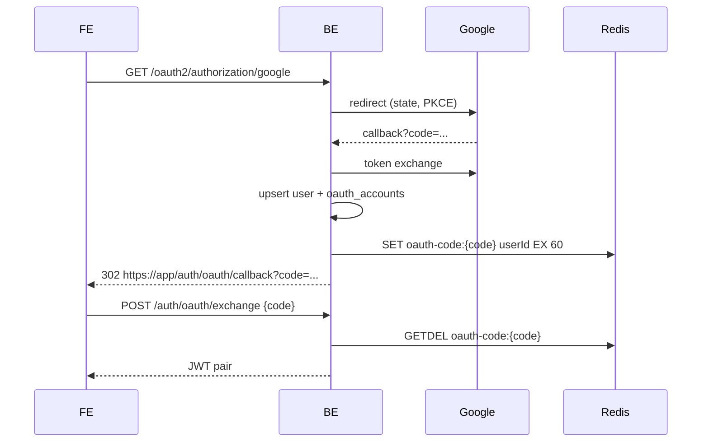

# Phase 03 — Authentication: Email/Password + OAuth + JWT + Refresh Rotation

## Context Links
- Parent: [plan.md](./plan.md)
- Prev: [phase-02-database-schema.md](./phase-02-database-schema.md)
- Next: [phase-04-vocabulary-srs.md](./phase-04-vocabulary-srs.md)
- Research: [researcher-01-auth-security-stack.md](./research/researcher-01-auth-security-stack.md) (all topics)
- Docs: [Spring Security 6](https://docs.spring.io/spring-security/reference/), [Auth.js v5](https://authjs.dev/), [JJWT 0.12.x](https://github.com/jwtk/jjwt)

## Overview
- **Date:** 2026-05-09
- **Priority:** P1
- **Status:** pending
- **Effort:** 16h
- **Description:** Stateless JWT auth on BE; NextAuth v5 on FE bridging. Email/password + Google + GitHub. Email verification + password reset via DB-backed one-time tokens. Refresh rotation w/ replay-detection in Redis. Bucket4j-Redis rate limit on auth endpoints.

## Key Insights
- HS256 for MVP (single secret env var); RS256 path documented (swap `JwtParserBuilder.verifyWith(...)` + `Jwts.SIG.RS256`).
- Refresh tokens: opaque random 256-bit hex, SHA-256 stored at `refresh:{userId}:{jti}` w/ 7d TTL. Rotation: presented refresh found → issue new pair, delete old. Not-found → revoke all user refresh keys (replay).
- OAuth flow: BE handles `oauth2Login`, on success generates one-time code (random hex, 60s TTL in Redis) → redirect to FE `/auth/oauth/callback?code=...`. FE POSTs code to BE `/auth/oauth/exchange` → JWT pair.
- NextAuth `jwt()` callback transparently refreshes when `Date.now() > expiresAt`.
- Bucket4j filter ordered before Spring Security to protect public endpoints.

## Requirements
**Functional**
- `POST /api/v1/auth/signup` (email, password, displayName) → 201 + send verification email.
- `GET /api/v1/auth/verify-email?token=...` → flips `email_verified=true`, marks token used.
- `POST /api/v1/auth/login` (email, password) → JWT pair (access 15m, refresh 7d).
- `POST /api/v1/auth/refresh` (refreshToken) → rotated pair.
- `POST /api/v1/auth/logout` (refreshToken) → revoke single refresh key.
- `POST /api/v1/auth/forgot-password` (email) → email link w/ reset token.
- `POST /api/v1/auth/reset-password` (token, newPassword) → updates hash, marks token used, revokes all refresh.
- `GET /oauth2/authorization/{google,github}` → provider redirect (Spring Security default).
- OAuth success → BE issues one-time code → FE exchanges via `POST /api/v1/auth/oauth/exchange`.
- Roles: USER (default), ADMIN (manual DB grant for MVP).

**Non-functional**
- BCrypt strength 12.
- HS256 secret ≥256 bits, env-injected (`JWT_SECRET`).
- Rate limits: login 5/min/IP, signup 3/min/IP, refresh 30/min/user, reset 3/hr/IP.
- All errors RFC 7807 `application/problem+json`.

## Architecture
### Login + Refresh Sequence

### OAuth2 Flow

## Related Code Files
**Backend `com.engly.auth`**
- `controller/AuthController.java` — endpoints listed above.
- `controller/OAuth2SuccessHandler.java` — generates one-time code, redirects.
- `service/AuthService.java` — signup, login, refresh, logout.
- `service/EmailVerificationService.java`
- `service/PasswordResetService.java`
- `service/OAuth2UserUpsertService.java`
- `service/RefreshTokenService.java` (Redis interactions)
- `service/MailService.java` (Spring Mail wrapper)
- `dto/SignupRequest.java`, `LoginRequest.java`, `TokenResponse.java`, `RefreshRequest.java`, `ForgotPasswordRequest.java`, `ResetPasswordRequest.java`, `OAuthExchangeRequest.java`
- `repository/UserRepository.java`, `OAuthAccountRepository.java`, `EmailVerificationTokenRepository.java`, `PasswordResetTokenRepository.java`
- `mapper/UserMapper.java`

**Backend `com.engly.common.security`**
- `JwtService.java` — sign + parse, HS256.
- `JwtAuthenticationFilter.java` — OncePerRequestFilter, sets SecurityContext.
- `SecurityConfig.java` — `SecurityFilterChain` bean.
- `OAuth2ClientConfig.java` — providers from `application.yml`.
- `RateLimitFilter.java` — Bucket4j-Redis (or use starter beans + `KeyResolver`).
- `KeyResolverConfig.java` — IP + user resolvers.
- `SecurityProperties.java` — `@ConfigurationProperties(prefix="engly.security")`.
- `CustomUserDetails.java` (implements `UserDetails`).
- `RestAuthenticationEntryPoint.java`, `RestAccessDeniedHandler.java` (RFC 7807).

**Backend `com.engly.common.exception`**
- `GlobalExceptionHandler.java` (`@RestControllerAdvice`) returning `ProblemDetail`.
- `ApiException.java`, `BadCredentialsException`, `EmailAlreadyExistsException`, etc.

**Backend resources**
- `application.yml` additions: `engly.security.jwt.secret`, `access-ttl-seconds: 900`, `refresh-ttl-seconds: 604800`, `engly.mail.from`, `spring.security.oauth2.client.registration.{google,github}.*`.
- `templates/email/verify.html`, `templates/email/reset.html` (Thymeleaf or simple String.format).

**Frontend `frontend/src/`**
- `auth.ts` — Auth.js v5 config (Credentials + Google + GitHub).
- `middleware.ts` — route protection.
- `lib/api/client.ts` — fetch wrapper, auto-attaches `Authorization: Bearer`, retries 401 once after `auth()` refresh.
- `lib/auth/session.ts` — server-side `auth()` helpers.
- `app/(auth)/login/page.tsx`, `app/(auth)/signup/page.tsx`, `app/(auth)/forgot-password/page.tsx`, `app/(auth)/reset-password/page.tsx`, `app/(auth)/verify-email/page.tsx`.
- `app/auth/oauth/callback/page.tsx` — exchanges one-time code.
- `components/features/auth/login-form.tsx`, `signup-form.tsx`, `forgot-password-form.tsx`, `reset-password-form.tsx`, `oauth-buttons.tsx`.
- `lib/validation/auth-schemas.ts` — Zod schemas.

## Implementation Steps
1. Add deps: `jjwt-api`, `jjwt-impl`, `jjwt-jackson`, `bucket4j-spring-boot-starter` w/ Redis backend, `spring-boot-starter-mail`, `spring-boot-starter-thymeleaf` (templates).
2. Create `JwtService.java` w/ `sign(userId, role, ttl, purpose)` + `parse(token, expectedPurpose)`. Use `Jwts.builder().issuer("engly").subject(userId).claim("role",role).claim("purpose",purpose).expiration(...)`.
3. Create `JwtAuthenticationFilter` reading `Authorization: Bearer ...`, parsing access JWT (purpose=`access`), populating `UsernamePasswordAuthenticationToken`.
4. Configure `SecurityConfig`:
   - `csrf().disable()`, `sessionManagement.sessionCreationPolicy(STATELESS)`.
   - `cors(...)` allowlist from properties.
   - `authorizeHttpRequests`: permitAll `/api/v1/auth/**`, `/oauth2/**`, `/actuator/health`, `/v3/api-docs/**`, `/swagger-ui/**`. Admin: `/api/v1/admin/**` hasRole(ADMIN). Anon-permitted: `/api/v1/words/word-of-the-day`.
   - `oauth2Login(o -> o.successHandler(oauth2SuccessHandler))`.
   - `addFilterBefore(jwtAuthenticationFilter, UsernamePasswordAuthenticationFilter.class)`.
   - `exceptionHandling(...)` with custom 401/403 handlers returning ProblemDetail.
5. `RefreshTokenService`: 
   - `issue(userId)` → generate 32-byte random hex, jti = UUID, store `SET refresh:{uid}:{jti} sha256(rt) EX 604800`. Return `{userId}.{jti}.{rt}` as the refresh string (so `/refresh` can parse without DB lookup).
   - `rotate(presented)` → split to `(uid, jti, rt)`. Lookup. If missing → `SCAN MATCH refresh:{uid}:* | DEL` → throw 401. If found and `sha256(rt)==stored` → DEL, issue new.
   - `revokeAll(userId)` → SCAN+DEL.
   - `revokeOne(presented)` → DEL specific key.
6. `AuthService.signup`: validate Zod-equivalent (Bean Validation) → check uniqueness → BCrypt hash → save User → create EmailVerificationToken (raw hex, hash stored) → send email.
7. `AuthService.login`: load user, check enabled, BCrypt match, fail-fast on `email_verified=false` (configurable: optional gate). Return JWT pair.
8. `EmailVerificationService.verify(rawToken)`: SHA-256 → query `email_verification_tokens` → check `used_at IS NULL` and `expires_at > now()` → flip `users.email_verified = true`, set `used_at = now()`.
9. `PasswordResetService.requestReset(email)`: lookup user (silent if not found — anti-enumeration), gen token (30-min TTL), email link `https://app/reset-password?token=...`.
10. `PasswordResetService.confirmReset(rawToken, newPassword)`: verify token → BCrypt new password → update → mark used → revoke all refresh tokens.
11. `OAuth2UserUpsertService.handleOAuth2User(provider, providerUserId, email, name, avatarUrl)`: find oauth_accounts row → if missing, find users by email; if missing, create User (no password_hash, email_verified=true). Link oauth_accounts row.
12. `OAuth2SuccessHandler`: extract OAuth2User principal → call upsert → generate one-time code (32-byte hex) → `SET oauth-code:{code} userId EX 60` → `response.sendRedirect(${frontend.url}/auth/oauth/callback?code=...)`.
13. `AuthController.exchangeOAuthCode(code)`: `GETDEL oauth-code:{code}` → if found userId → issue JWT pair.
14. `RateLimitFilter` config (Bucket4j starter):
   - `engly.bucket4j.filters[0]` for `/api/v1/auth/login` capacity 5 / 1 min, key `ip`.
   - `[1]` `/api/v1/auth/signup` 3/1min `ip`.
   - `[2]` `/api/v1/auth/refresh` 30/1min `user` (resolved from JWT subject if present, else IP).
   - `[3]` `/api/v1/auth/forgot-password` 3/1hr `ip`.
   - On limit: 429 + `Retry-After`.
15. `MailService.sendVerification(user, link)` and `sendReset(user, link)` — Thymeleaf templates, dev sends to Mailhog.
16. `GlobalExceptionHandler`:
   - `MethodArgumentNotValidException` → 422 + field errors map.
   - `BadCredentialsException` → 401.
   - `AccessDeniedException` → 403.
   - `EmailAlreadyExistsException` → 409.
   - generic → 500 (no stack to client).
17. **Frontend `auth.ts`** (Auth.js v5):
   - Credentials provider `authorize()` POSTs to BE `/api/v1/auth/login`, returns `{id,email,accessToken,refreshToken,expiresAt}`.
   - Google + GitHub providers: `signIn` redirects to `${BE}/oauth2/authorization/{provider}`. Handle callback page (BE redirects there with one-time code) — page calls `signIn("oauth-exchange", {code})` (a 2nd Credentials provider named `oauth-exchange` whose `authorize` calls BE `/auth/oauth/exchange`).
   - `jwt()` callback: store access+refresh+expiresAt+userId. On expiry, call `/auth/refresh`. On failure, set `error: "RefreshFailed"`.
   - `session()` callback: expose `accessToken`, `user.id`, `user.role`, `error`.
18. **Frontend `middleware.ts`**: redirect `/dashboard/*` etc. to `/login` if no session; redirect `/login`+`/signup` to `/dashboard` if session exists.
19. **Frontend `lib/api/client.ts`**: `fetch` wrapper that calls `auth()` for accessToken. On 401 → call `signOut({redirect:false})` then redirect to `/login` (refresh handled by NextAuth callback automatically; explicit retry not needed since `auth()` already returns fresh token).
20. **Frontend pages**: forms using react-hook-form + Zod, shadcn `Input`, `Button`, `Form`, error states.
21. Test happy paths via Postman/HTTPie + verify Mailhog UI receives emails.
22. Add integration tests (deferred to phase-08, but stub now): `AuthIntegrationTest extends AbstractIntegrationTest`.

## Todo List
- [ ] JwtService HS256 sign/parse
- [ ] JwtAuthenticationFilter
- [ ] SecurityConfig stateless + CORS + filters wired
- [ ] RefreshTokenService Redis-backed w/ rotation + replay-detect
- [ ] AuthService signup/login/logout
- [ ] EmailVerificationService + endpoint
- [ ] PasswordResetService + 2 endpoints
- [ ] OAuth2 success handler + one-time code exchange
- [ ] Bucket4j rate limit on 4 endpoints
- [ ] MailService + Thymeleaf templates
- [ ] GlobalExceptionHandler RFC 7807
- [ ] Frontend Auth.js v5 config
- [ ] FE login/signup/forgot/reset/verify pages
- [ ] FE oauth callback page
- [ ] FE middleware route protection
- [ ] FE api client wrapper

## Success Criteria
- New user can: signup → receive verify email (mailhog) → verify → login → receive JWT pair → call protected endpoint.
- Refresh rotation: presented stale refresh returns 401 + revokes all user refreshes (verified via SCAN).
- OAuth: login via Google → returns to FE callback → session active.
- Rate limit: 6th login attempt in 1 minute returns 429 with `Retry-After`.
- Forgot password: receive email → reset → old refresh tokens invalidated.

## Risk Assessment
- **Risk:** JWT secret leak → **Mitigation:** env-only, never in git; rotation playbook documented in phase-08 deployment-guide.
- **Risk:** Email enumeration via signup conflict → **Mitigation:** Generic "If account exists, email sent" responses on forgot-password; signup keeps explicit error since user-experience needs it (acceptable tradeoff documented).
- **Risk:** Refresh-token rotation race (two tabs refresh simultaneously) → **Mitigation:** atomic `GETDEL`-style via Lua script; old token already deleted on rotate so 2nd request 401s legitimately. Document UX: tabs need re-login (acceptable for MVP).
- **Risk:** OAuth account hijack via email collision → **Mitigation:** if existing user has password_hash and email matches OAuth claim, REQUIRE the user to log in via password first then "link" OAuth (post-MVP). For MVP: link silently if email_verified=true on existing account (research-supported).
- **Risk:** Bucket4j Redis dependency single point → **Mitigation:** filter open-fails on Redis down (allow request) w/ alarm log.

## Security Considerations
- BCrypt strength 12; argon2id documented as future upgrade.
- CORS strict allowlist; `allowCredentials=false` (Bearer header only).
- `httpOnly` is moot (no cookies on BE); NextAuth handles its own cookie (HTTPS-only in prod).
- Replay-detection on refresh = OWASP best practice.
- One-time OAuth code TTL 60s; never logged.
- Email/reset tokens hashed at rest; raw shown only in email link.
- Standard Spring Security headers: X-Content-Type-Options, X-Frame-Options DENY, Referrer-Policy, HSTS (prod profile).
- CSRF disabled (stateless API w/ Bearer); document in code-standards.
- Logging: never log Authorization header, password, or token values; SLF4J markers for security audit events (login_success/failure/lockout).

## Next Steps
[phase-04-vocabulary-srs.md](./phase-04-vocabulary-srs.md). Phase 03 unblocks both vocab and grammar phases (parallel-eligible after auth).
