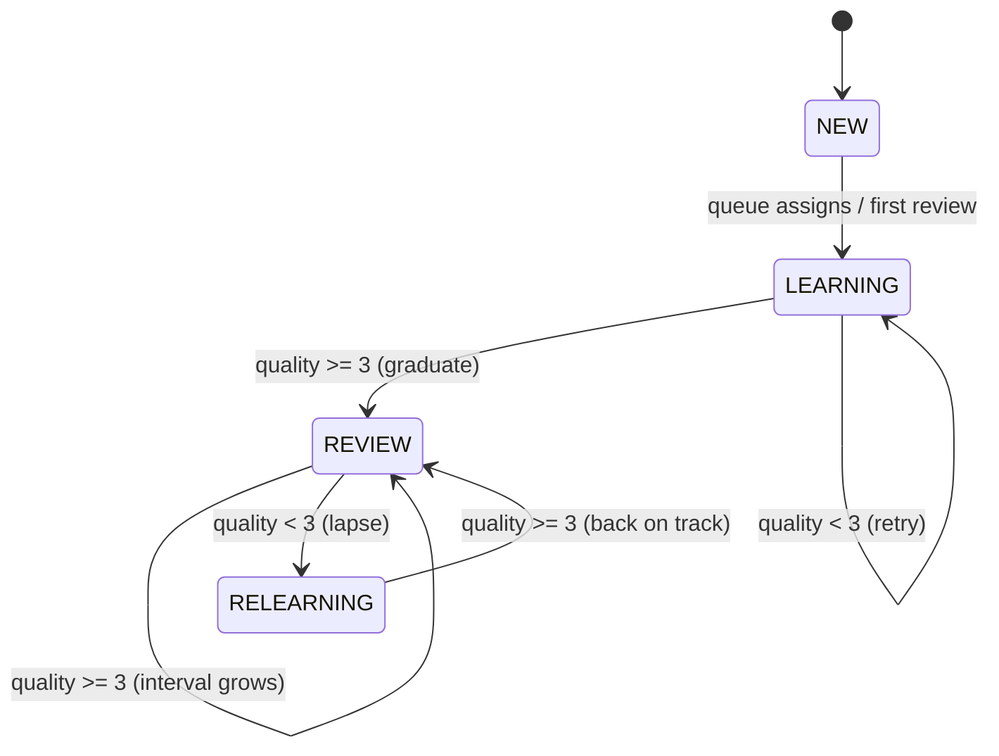

# Phase 04 — Vocabulary & SRS (SM-2)

## Context Links
- Parent: [plan.md](./plan.md)
- Prev: [phase-03-authentication.md](./phase-03-authentication.md)
- Next: [phase-05-grammar-quizzes.md](./phase-05-grammar-quizzes.md) (parallelizable)
- Research: [researcher-02-learning-algos-and-infra.md](./research/researcher-02-learning-algos-and-infra.md) (§A SM-2)
- Docs: [Anki algo](https://faqs.ankiweb.net/what-spaced-repetition-algorithm)

## Overview
- **Date:** 2026-05-09
- **Priority:** P1
- **Status:** pending
- **Effort:** 12h
- **Description:** Word management (admin CRUD), per-user SRS cards, SM-2 scheduler (pure function), daily review queue, daily new-card limit, word-of-the-day. Frontend flashcard UI with 4-button rating.

## Key Insights
- SM-2 is pure: takes `(card, quality 0–5)` returns updated card. Easy to unit-test.
- Anki-style mapping: Again=0, Hard=2, Good=3, Easy=4. Avoid 1 and 5 (rarely used in practice).
- Daily new-card limit: count `srs_cards WHERE state IN ('LEARNING') AND created_at >= today_user_tz` < `dailyNewCardsLimit` (default 10).
- Word-of-the-day: deterministic seed `SHA256(date_iso) mod count(words)` — no DB write needed.
- `next_review_date` indexed → due-queue is `WHERE user_id = ? AND next_review_date <= now() ORDER BY next_review_date LIMIT 50`.

## Requirements
**Functional**
- `GET /api/v1/words` (admin): paginated list, filter by cefr/text.
- `POST /api/v1/admin/words`: create word.
- `PUT /api/v1/admin/words/{id}`: update.
- `DELETE /api/v1/admin/words/{id}`: soft? — MVP hard delete with `RESTRICT` if SrsCards exist (return 409).
- `GET /api/v1/words/word-of-the-day`: anonymous-allowed, returns one Word.
- `GET /api/v1/vocab/queue?limit=50`: due cards for current user. Auto-creates new cards (up to daily limit) for words user hasn't started yet, oldest words first, prefer current user's CEFR ±1.
- `POST /api/v1/vocab/review` `{cardId, quality}`: applies SM-2 → returns updated card. Side-effects: emits XP event (5 XP via EventPublisher in Phase 6), updates daily_activity, updates streak.
- `GET /api/v1/vocab/stats`: total reviews, learned (state=REVIEW), learning, accuracy.

**Non-functional**
- SM-2 logic isolated, deterministic, side-effect free → unit testable.
- Queue endpoint <300ms p95 with index on `(user_id, next_review_date)`.
- Daily-limit logic uses user's IANA timezone.

## Architecture (SRS State Machine)


## Related Code Files
**Backend `com.engly.vocabulary`**
- `controller/WordController.java` (public + admin)
- `controller/SrsController.java` (`/vocab/queue`, `/vocab/review`, `/vocab/stats`)
- `service/WordService.java` (CRUD + word-of-the-day)
- `service/SrsService.java` (queue assembly + review apply)
- `service/QueueAssemblerService.java` (handles new-card injection logic)
- `srs/Sm2Scheduler.java` (pure static fn)
- `srs/CardState.java` (enum)
- `repository/WordRepository.java`
- `repository/SrsCardRepository.java`
- `dto/WordDto.java`, `WordCreateRequest.java`, `WordUpdateRequest.java`, `SrsCardDto.java`, `ReviewRequest.java`, `VocabStatsDto.java`
- `mapper/WordMapper.java`, `SrsCardMapper.java`
- `event/VocabReviewedEvent.java` (Spring `ApplicationEvent`, consumed by gamification phase)

**Frontend**
- `app/vocab/page.tsx` — main review page (queue + flashcard).
- `app/vocab/stats/page.tsx`
- `app/admin/words/page.tsx` — admin table (ADMIN role).
- `components/features/vocab/flashcard.tsx` — flip animation (Tailwind `transform-style: preserve-3d`).
- `components/features/vocab/rating-buttons.tsx` — Again/Hard/Good/Easy.
- `components/features/vocab/word-of-the-day-card.tsx`
- `components/features/admin/word-form.tsx`, `word-table.tsx`
- `hooks/use-vocab-queue.ts`, `hooks/use-review-mutation.ts`
- `lib/api/vocab-api.ts`

## Implementation Steps
1. Implement `Sm2Scheduler.scheduleNext(SrsCard card, int quality)` exactly per research:
```java
public static SrsCard scheduleNext(SrsCard card, int quality, ZoneId userZone) {
  if (quality < 0 || quality > 5) throw new IllegalArgumentException("quality 0-5");
  if (quality < 3) {
    card.setLapses(card.getLapses() + 1);
    card.setRepetitions(0);
    card.setState(CardState.RELEARNING);
    card.setIntervalDays(0);
    card.setNextReviewDate(Instant.now().plus(1, ChronoUnit.DAYS));
  } else {
    card.setRepetitions(card.getRepetitions() + 1);
    card.setState(CardState.REVIEW);
    int newInterval = switch (card.getIntervalDays()) {
      case 0 -> 1;
      case 1 -> 6;
      default -> Math.min(36500, (int) Math.round(card.getIntervalDays() * card.getEaseFactor()));
    };
    card.setIntervalDays(newInterval);
    card.setNextReviewDate(Instant.now().plus(newInterval, ChronoUnit.DAYS));
  }
  double newEase = card.getEaseFactor() + 0.1 - (5 - quality) * (0.08 + (5 - quality) * 0.02);
  card.setEaseFactor(Math.max(1.3, newEase));
  card.setLastReviewedAt(Instant.now());
  return card;
}
```
2. Unit test SM-2 with table-driven cases: NEW→LEARNING, LEARNING→REVIEW (quality=3), REVIEW→RELEARNING (quality=2), ease floor at 1.3, interval cap at 36500.
3. `WordRepository`: pageable findAll w/ optional `cefr` filter; `existsByText(String)`.
4. `SrsCardRepository`:
   - `List<SrsCard> findByUserIdAndNextReviewDateLessThanEqualOrderByNextReviewDate(UUID userId, Instant now, Pageable pageable)`.
   - `long countByUserIdAndStateAndCreatedAtAfter(UUID userId, CardState state, Instant since)` (for daily limit).
   - `Optional<SrsCard> findByUserIdAndWordId(UUID, UUID)` (for unique upsert).
5. `WordService`: CRUD methods. `wordOfTheDay()`:
```java
public Word wordOfTheDay() {
  long count = wordRepo.count();
  if (count == 0) throw new NoWordsAvailableException();
  long index = Math.abs(LocalDate.now(ZoneOffset.UTC).toString().hashCode()) % count;
  return wordRepo.findAll(PageRequest.of((int) index, 1)).getContent().get(0);
}
```
6. `QueueAssemblerService.assembleQueue(User user, int limit)`:
   - Step 1: load due cards (state ∈ REVIEW/RELEARNING/LEARNING with next_review_date ≤ now), up to `limit`.
   - Step 2: if room remains AND new-cards-today < dailyLimit: pick `min(remaining, dailyLimit - already)` words user has no card for, prefer matching CEFR (user.cefrSelfRating or A1 default), order by `cefr ASC, text ASC`. Create SrsCard rows w/ state=LEARNING, intervalDays=0, nextReviewDate=now (so they show immediately). Return concatenated list.
7. `SrsService.applyReview(UUID userId, UUID cardId, int quality)`:
   - Load card, assert ownership.
   - Call `Sm2Scheduler.scheduleNext`.
   - Save (`@Version` optimistic lock; on `OptimisticLockException` → 409 Conflict).
   - Publish `VocabReviewedEvent(userId, cardId, quality)`.
   - Return DTO.
8. Endpoints in `SrsController`:
   - `GET /api/v1/vocab/queue?limit=50` (default 20, max 50).
   - `POST /api/v1/vocab/review` body `{cardId, quality}`.
   - `GET /api/v1/vocab/stats`.
9. `WordController`: anonymous `GET /api/v1/words/word-of-the-day`. Admin `POST/PUT/DELETE /api/v1/admin/words[/{id}]`.
10. Bean Validation on DTOs: `@NotBlank`, `@Size(max=80)` for word text, `@Pattern` for CEFR.
11. **FE flashcard component**:
   - State: `flipped` boolean.
   - Front: word.text + IPA + audio button (if `audio_url`).
   - Back: definitions, examples, tags.
   - Tailwind 3D flip via `transform: rotateY(180deg)` + `backface-visibility: hidden`.
12. **FE rating buttons**: 4 shadcn Buttons (Again red, Hard amber, Good emerald, Easy sky). Submit via `useReviewMutation`. On success: TanStack Query `invalidateQueries(['vocab','queue'])`, advance to next card.
13. **FE queue page**: TanStack `useQuery(['vocab','queue'])`. Show progress: `cardsReviewed / queueLength`. On empty queue: empty state + link to dashboard.
14. **FE word-of-the-day card** on dashboard: `useQuery(['word-of-the-day'])`, `staleTime: 24h`.
15. **FE admin words page**: paginated table, create/edit dialog, delete confirm. Guarded by session role.
16. Add `@PreAuthorize("hasRole('ADMIN')")` on admin controller methods (or restrict via SecurityConfig path matchers — choose one, document).
17. Smoke test: seed + queue + 5 reviews → check `srs_cards` rows updated, `next_review_date` shifted.

## Todo List
- [ ] Sm2Scheduler pure function + unit tests
- [ ] WordRepository, SrsCardRepository
- [ ] WordService CRUD + word-of-the-day
- [ ] QueueAssemblerService new-card injection
- [ ] SrsService.applyReview + event publish
- [ ] Controllers w/ admin guards
- [ ] DTOs + Bean Validation
- [ ] MapStruct mappers
- [ ] FE flashcard component (3D flip)
- [ ] FE rating buttons + mutation
- [ ] FE queue page
- [ ] FE word-of-the-day card
- [ ] FE admin words table + form
- [ ] Audio playback (HTMLAudio when audio_url present)

## Success Criteria
- Seeded user with 0 cards → call queue → 10 LEARNING cards created (daily limit).
- Review card with quality=3 → state LEARNING→REVIEW, interval=1, next_review_date=tomorrow.
- 11th new card not auto-created same day.
- Word-of-the-day stable for 24h UTC.
- Admin can CRUD words; non-admin gets 403.
- SM-2 unit tests cover all branches incl ease floor + interval cap.

## Risk Assessment
- **Risk:** Race on `applyReview` (double-click) → **Mitigation:** `@Version`; FE button disable during mutation.
- **Risk:** Daily-limit double-count if new cards created concurrently → **Mitigation:** count + create wrapped in `@Transactional`; for high concurrency add `SELECT ... FOR UPDATE` on user row (deferred — KISS).
- **Risk:** Word-of-the-day deterministic but skewed if word count <365 → **Mitigation:** OK for MVP (50 words, daily rotation cycles).
- **Risk:** Audio URL hotlinking → **Mitigation:** only allow URLs from known CDNs in admin form Zod schema (allowlist); MVP skips this check, document as follow-up.

## Security Considerations
- Admin endpoints role-checked.
- Quality value range-validated (no negative, no >5).
- Card ownership asserted in `applyReview` (`card.userId == authPrincipal.userId` else 404 not 403, to avoid card-id enumeration).
- No raw word-id leakage in stats endpoint.

## Next Steps
[phase-05-grammar-quizzes.md](./phase-05-grammar-quizzes.md) (parallelizable). Phase 06 consumes `VocabReviewedEvent` for XP.
