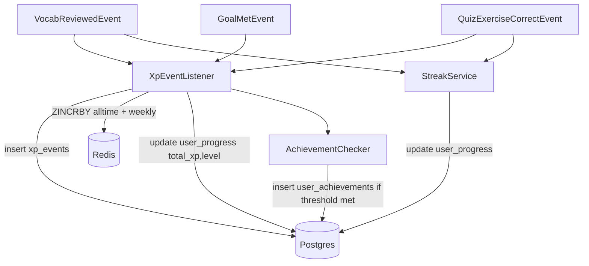

# Phase 06 — Gamification: XP, Streak, Leaderboard, Achievements

## Context Links
- Parent: [plan.md](./plan.md)
- Prev: [phase-04-vocabulary-srs.md](./phase-04-vocabulary-srs.md), [phase-05-grammar-quizzes.md](./phase-05-grammar-quizzes.md)
- Next: [phase-07-profile-dashboard.md](./phase-07-profile-dashboard.md)
- Research: [researcher-02-learning-algos-and-infra.md](./research/researcher-02-learning-algos-and-infra.md) (§B leaderboard, §C streak)

## Overview
- **Date:** 2026-05-09
- **Priority:** P1
- **Status:** pending
- **Effort:** 8h
- **Description:** Award XP on vocab review (+5), quiz correct answer (+10), daily-goal-met (+50). Lazy-on-read streak. Redis ZSET leaderboards (alltime + ISO-week). Event-driven achievement checks.

## Key Insights
- Single `XpEvent` listener handles all XP-emitting events; idempotency via `ref_id` unique constraint optional (skip MVP — let duplicates exist; double-count edge case acceptable).
- `ZINCRBY` is atomic; concurrent awards safe.
- Streak update: lazy on first activity-of-day per user. Idempotent: same-day repeat returns prog unchanged.
- Achievement check is dumb: load count from DB/Redis vs threshold. Listener pattern keeps achievements decoupled from XP source.
- Daily goal +50 awarded **once** per `daily_activity (user_id, activity_date) = goal_met` flip; enforced by row-level check (`UPDATE ... WHERE goal_met=false`).

## Requirements
**Functional**
- Vocab review → +5 XP, streak update, daily_activity bump.
- Quiz exercise correct → +10 XP, daily_activity bump.
- Quiz completed perfect → check `PERFECT_QUIZ` achievement.
- Daily activity total XP ≥ user.dailyGoalXp → flip `goal_met=true`, +50 bonus, unlock streak day.
- `GET /api/v1/leaderboard?scope=alltime|weekly&limit=50`: top N + current user with neighbors (3 above, 3 below).
- `GET /api/v1/me/progress`: streak, total_xp, level, daily progress %.
- `GET /api/v1/me/achievements`: list unlocked w/ unlocked_at + locked w/ progress %.
- Achievement event: WS optional (defer); MVP returns "newly_unlocked" array in same response that triggered the unlock.

**Non-functional**
- All Redis ops single-key atomic; no read-modify-write.
- Streak update ≤50ms p95.
- Leaderboard read ≤100ms p95.

## Architecture


## Related Code Files
**Backend `com.engly.gamification`**
- `service/XpService.java` — central event listener.
- `service/StreakService.java` — lazy on-read.
- `service/LeaderboardService.java` — Redis ZSET ops.
- `service/AchievementService.java`
- `service/DailyActivityService.java`
- `service/LevelCalculator.java` (pure: `level = totalXp / 1000 + 1`).
- `repository/UserProgressRepository.java`, `XpEventRepository.java`, `AchievementRepository.java`, `UserAchievementRepository.java`, `DailyActivityRepository.java`
- `controller/LeaderboardController.java`
- `controller/MeProgressController.java` — `/me/progress`, `/me/achievements`.
- `dto/LeaderboardEntryDto.java`, `LeaderboardResponseDto.java`, `ProgressDto.java`, `AchievementDto.java`
- `event/XpAwardedEvent.java`, `GoalMetEvent.java`
- `config/GamificationProperties.java` — XP amounts, thresholds.

**Constants** (in `GamificationProperties` or a `XpAmounts` record)
```java
record XpAmounts(int vocabReview, int quizCorrect, int dailyGoal) {}
// defaults: 5, 10, 50
```

**Frontend**
- `components/features/gamification/streak-flame.tsx`
- `components/features/gamification/xp-progress-bar.tsx` (level + bar to next)
- `components/features/gamification/level-badge.tsx`
- `components/features/gamification/achievement-grid.tsx`
- `components/features/gamification/achievement-toast.tsx` (sonner / shadcn `useToast`)
- `app/leaderboard/page.tsx` — tabs alltime / weekly.
- `hooks/use-leaderboard.ts`, `use-progress.ts`, `use-achievements.ts`.
- `lib/api/gamification-api.ts`.

## Implementation Steps
1. `LevelCalculator.calculateLevel(long totalXp)` returns `(int)(totalXp / 1000) + 1`.
2. `XpService.awardXp(UUID userId, int amount, String source, UUID refId)` — `@Transactional`:
   - Insert `XpEvent`.
   - Update `user_progress`: `total_xp += amount; level = calc(total_xp)`.
   - Update `daily_activity` for today (user TZ): increment counter, increment `xp_earned`.
   - If new total xp_earned ≥ `user.dailyGoalXp` AND `goal_met=false` → set `goal_met=true`, publish `GoalMetEvent` (re-entrant award of +50, with source=DAILY_GOAL — recursion guard: check source ≠ DAILY_GOAL).
   - ZINCRBY alltime + weekly leaderboards.
   - Trigger `AchievementService.checkAfterXp`.
3. `StreakService.recordActivity(UUID userId)`:
```java
@Transactional
public UserProgress recordActivity(UUID userId) {
  User u = userRepo.findById(userId).orElseThrow();
  ZoneId zone = ZoneId.of(u.getTimezone());
  LocalDate today = LocalDate.now(zone);
  UserProgress p = userProgressRepo.findById(userId).orElseGet(() -> create(userId));
  if (today.equals(p.getLastActivityDate())) return p;
  if (p.getLastActivityDate() != null && today.minusDays(1).equals(p.getLastActivityDate())) {
    p.setCurrentStreak(p.getCurrentStreak() + 1);
  } else {
    p.setCurrentStreak(1);
  }
  p.setLongestStreak(Math.max(p.getLongestStreak(), p.getCurrentStreak()));
  p.setLastActivityDate(today);
  return userProgressRepo.save(p); // @Version retry-on-conflict via @Retryable optional
}
```
4. `LeaderboardService`:
```java
private static final String ALLTIME = "leaderboard:xp:alltime";
private String weeklyKey() {
  LocalDate d = LocalDate.now(ZoneOffset.UTC);
  int year = d.get(IsoFields.WEEK_BASED_YEAR);
  int week = d.get(IsoFields.WEEK_OF_WEEK_BASED_YEAR);
  return "leaderboard:xp:weekly:%d-W%02d".formatted(year, week);
}
public void awardXp(UUID userId, long xp) {
  ZSetOperations<String,String> ops = redis.opsForZSet();
  ops.incrementScore(ALLTIME, userId.toString(), xp);
  String wk = weeklyKey();
  Boolean isNew = (ops.score(wk, userId.toString()) == null);
  ops.incrementScore(wk, userId.toString(), xp);
  if (Boolean.TRUE.equals(isNew)) redis.expire(wk, Duration.ofDays(8));
}
public LeaderboardResponseDto top(String scope, int limit, UUID currentUser) {
  String key = "weekly".equals(scope) ? weeklyKey() : ALLTIME;
  Set<TypedTuple<String>> top = redis.opsForZSet().reverseRangeWithScores(key, 0, limit-1);
  Long rank = redis.opsForZSet().reverseRank(key, currentUser.toString());
  Set<TypedTuple<String>> neighbors = rank == null ? Set.of() :
    redis.opsForZSet().reverseRangeWithScores(key, Math.max(0, rank-3), rank+3);
  // hydrate user info (display_name, avatar) from Postgres in single batch
  return assemble(top, neighbors, rank);
}
```
5. `AchievementService.checkAfterXp(User user)`:
   - `STREAK_7`: if `user_progress.current_streak >= 7` → unlock if not already.
   - `WORDS_100`: count `srs_cards WHERE state=REVIEW AND user_id=?` ≥ 100.
   - `XP_1000`: total_xp ≥ 1000.
   - On unlock: insert `user_achievements`, return list of newly unlocked codes (for client toast).
6. `checkAfterQuizCompleted(User user, double percent)`:
   - `PERFECT_QUIZ`: percent == 1.0.
7. **Listeners** — Spring `@EventListener`:
   - `@TransactionalEventListener(phase=AFTER_COMMIT)` on `VocabReviewedEvent` → calls XpService + StreakService.
   - same on `QuizExerciseCorrectEvent` → XpService.
   - same on `QuizCompletedEvent` → AchievementService.checkAfterQuizCompleted.
   - same on `GoalMetEvent` → XpService.awardXp(50, DAILY_GOAL).
8. **Controllers**:
   - `LeaderboardController.GET /api/v1/leaderboard?scope=&limit=`.
   - `MeProgressController.GET /api/v1/me/progress`, `GET /api/v1/me/achievements`.
9. **Backfill helper** (admin-only): `POST /api/v1/admin/leaderboard/rebuild` — re-aggregates `xp_events.amount` per user → DEL + ZADD batch. Used if Redis lost or out-of-sync.
10. **FE streak flame**: shows `current_streak` w/ flame SVG; "today done" green tint, "today pending" amber, "broken yesterday" gray.
11. **FE XP bar**: `xp_in_level = total_xp % 1000`, percent = `xp_in_level / 1000 * 100`. Animate fill.
12. **FE leaderboard page**: shadcn `Tabs` (alltime/weekly), table w/ rank, avatar, displayName, XP, badge if =current user. "Your rank" panel above with neighbors.
13. **FE achievement grid**: 3-col grid; locked = grayscale + lock icon; unlocked = colored + tooltip showing date.
14. **FE achievement toast**: TanStack mutation onSuccess inspects response for `newly_unlocked` array → `toast.success("New achievement: ...")`.
15. **Idempotency note** (deferred but documented): use `xp_events (user_id, source, ref_id)` unique partial index in V9 future migration if dedup needed.

## Todo List
- [ ] LevelCalculator pure fn
- [ ] XpService.awardXp transactional path
- [ ] StreakService lazy on-read
- [ ] LeaderboardService alltime + weekly w/ TTL
- [ ] AchievementService checks (4 codes)
- [ ] Spring @TransactionalEventListener wiring
- [ ] Repositories + DTOs
- [ ] Controllers (leaderboard + me/progress + me/achievements)
- [ ] Admin rebuild endpoint
- [ ] FE streak flame
- [ ] FE XP bar + level badge
- [ ] FE leaderboard page (tabs + neighbors)
- [ ] FE achievement grid
- [ ] FE achievement toast on unlock

## Success Criteria
- Vocab review → +5 XP visible in `me/progress` and leaderboard.
- 10 reviews + 1 perfect 5-question quiz → 50+50=100 XP + bonus +50 if daily goal=50 → 150 XP, level=1, current_streak=1, leaderboard reflects.
- Same-day repeated activity does NOT increment streak.
- Cross-day with consecutive activity → streak=2.
- Skip a day → next activity resets streak=1.
- Leaderboard top-50 stable; user-with-neighbors response correct.
- Achievement toast appears once on first unlock (not subsequent reviews).
- Weekly leaderboard auto-expires 8 days after creation (verify TTL).

## Risk Assessment
- **Risk:** Redis down → leaderboards skip; XP still accrues in Postgres → **Mitigation:** XpService catches RedisException, logs WARN, continues; admin rebuild endpoint reconciles.
- **Risk:** Streak race (two devices, same second) → **Mitigation:** `@Version` retries; same-day idempotency check.
- **Risk:** Daily-goal recursion on `awardXp(DAILY_GOAL)` → **Mitigation:** explicit guard `if (source != DAILY_GOAL) checkGoalMet(...)`.
- **Risk:** Weekly key collision across years → **Mitigation:** `WEEK_BASED_YEAR` (not `YEAR`) prevents week-53 split.
- **Risk:** Leaderboard hot-key write-amp at scale → **Mitigation:** sharding documented; not implemented MVP.

## Security Considerations
- Leaderboard exposes display_name + avatar only (not email).
- User can opt out of leaderboard (future setting `leaderboard_visible`); MVP all visible — document.
- Admin rebuild endpoint role-gated.
- Avatar URL sanitized (allow-list https schemes only).

## Next Steps
[phase-07-profile-dashboard.md](./phase-07-profile-dashboard.md) — composes everything in dashboard widgets.
