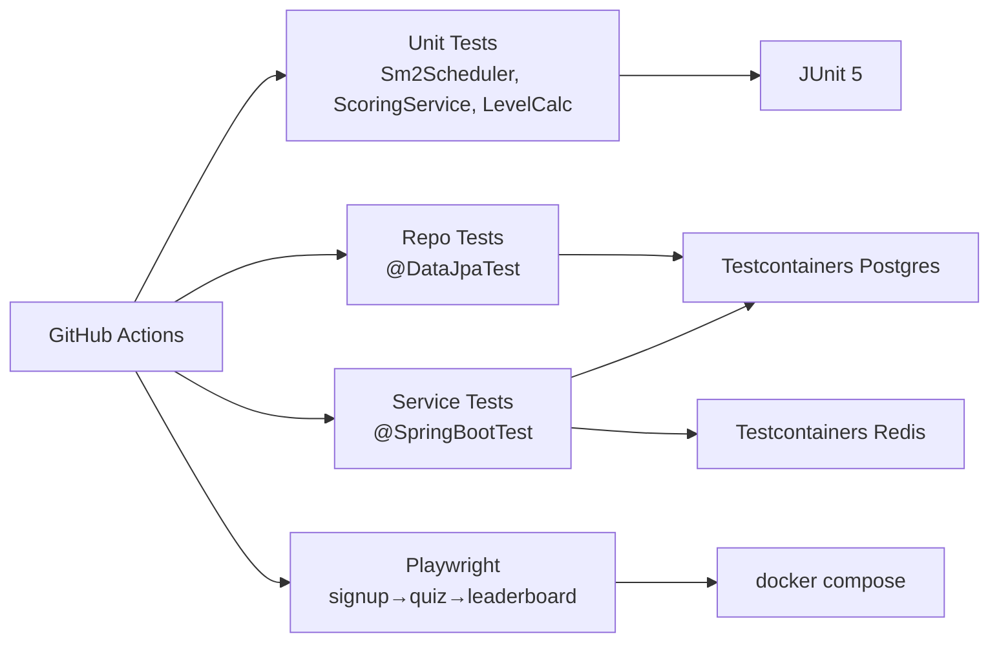

# Phase 08 — Testing, Hardening & Documentation

## Context Links
- Parent: [plan.md](./plan.md)
- Depends on: phases 01–07 complete
- Research: [researcher-02-learning-algos-and-infra.md](./research/researcher-02-learning-algos-and-infra.md) (§E Testcontainers)
- Docs: [Spring Security headers](https://docs.spring.io/spring-security/reference/servlet/exploits/headers.html), [Next.js CSP](https://nextjs.org/docs/app/building-your-application/configuring/content-security-policy), [Playwright](https://playwright.dev/)

## Overview
- **Date:** 2026-05-09
- **Priority:** P1
- **Status:** pending
- **Effort:** 12h
- **Description:** Comprehensive integration tests with Testcontainers (auth, vocab, grammar, gamification), Playwright E2E golden path, security hardening (headers, CSP, CSRF rationale), API docs polish, project docs in `/docs`, threat model.

## Key Insights
- Use `@DataJpaTest` for repo-only assertions; `@SpringBootTest` for end-to-end controller flows.
- Testcontainers reuse cuts test time ~30%.
- Playwright runs against `docker compose` stack via `webServer` config or assumes already-running.
- Spring Security 6 sets safe defaults (X-Content-Type-Options, X-Frame-Options DENY) — make explicit in config.
- Next.js CSP via middleware for response headers; nonce strategy for inline scripts (next-auth, RSC).

## Requirements
**Functional**
- 1 test class per feature module (auth, vocab, grammar, gamification, profile).
- ≥70% coverage on service layer (JaCoCo report).
- Playwright E2E covers: signup → email verify (mailhog API) → login → review → quiz → leaderboard → logout.
- All security headers present in BE responses.
- CSP configured on FE.
- README + 4 docs files in `/docs`.

**Non-functional**
- CI runs all tests; failure blocks merge.
- E2E flake-rate <2% (retry once allowed).

## Architecture (testing layers)


## Related Code Files
**Backend tests**
- `src/test/java/com/engly/AbstractIntegrationTest.java` (already in phase-01)
- `src/test/java/com/engly/auth/AuthControllerIntegrationTest.java` — signup/login/refresh/logout/oauth-exchange/verify/reset.
- `src/test/java/com/engly/auth/RefreshTokenServiceTest.java` — rotation + replay-detect.
- `src/test/java/com/engly/auth/RateLimitFilterIntegrationTest.java`.
- `src/test/java/com/engly/vocabulary/Sm2SchedulerUnitTest.java` — table-driven.
- `src/test/java/com/engly/vocabulary/SrsServiceIntegrationTest.java`.
- `src/test/java/com/engly/vocabulary/QueueAssemblerIntegrationTest.java` — daily-limit.
- `src/test/java/com/engly/grammar/ScoringServiceUnitTest.java`.
- `src/test/java/com/engly/grammar/QuizServiceIntegrationTest.java`.
- `src/test/java/com/engly/grammar/PublicDtoLeakageTest.java` — assert correct_answer never serialized to public DTO.
- `src/test/java/com/engly/gamification/StreakServiceIntegrationTest.java` — same-day idempotency, consecutive day, gap reset.
- `src/test/java/com/engly/gamification/LeaderboardServiceIntegrationTest.java` — ZINCRBY, top-N, neighbors, weekly TTL.
- `src/test/java/com/engly/gamification/AchievementServiceIntegrationTest.java`.
- `src/test/java/com/engly/user/MeControllerIntegrationTest.java` — change-password revokes refresh.
- `src/test/java/com/engly/user/StatsAggregationIntegrationTest.java`.
- `src/test/resources/application-test.yml` (mostly empty; @ServiceConnection wires).

**Frontend tests**
- `frontend/playwright.config.ts`.
- `frontend/e2e/golden-path.spec.ts` — full flow.
- `frontend/e2e/auth-flows.spec.ts` — signup, forgot, reset.
- `frontend/e2e/helpers/mailhog.ts` — fetch latest email via Mailhog API `:8025/api/v2/messages`.
- `frontend/e2e/helpers/test-data.ts` — random user factory.

**Docs (`/docs`)**
- `project-overview-pdr.md` — vision, MVP scope, non-goals.
- `system-architecture.md` — component diagram, sequence diagrams, data model.
- `code-standards.md` — Java naming, kebab-case for non-Java files (acknowledge Java PascalCase exception), package-by-feature, Lombok usage, Mapstruct usage.
- `deployment-guide.md` — env vars list, JWT secret rotation, Postgres migration apply, Redis backup, prod docker-compose example.
- `codebase-summary.md` — module layout, key files index.
- `design-guidelines.md` — color tokens, spacing, dark-mode contrast.
- `project-roadmap.md` — phases done + future (FSRS, multi-module, mobile app).
- `project-changelog.md` — versioned releases.
- `security-threat-model.md` — STRIDE table.

**Root**
- `README.md` finalized: badges (build, license), quick-start, tech stack, contribute, license.
- `LICENSE` (MIT default unless user specifies).

## Implementation Steps
### Backend testing
1. Configure JaCoCo plugin in `build.gradle.kts`:
```kotlin
plugins { id("jacoco") }
tasks.jacocoTestReport {
  dependsOn(tasks.test)
  reports { xml.required.set(true); html.required.set(true) }
}
tasks.jacocoTestCoverageVerification {
  violationRules { rule { limit { minimum = "0.70".toBigDecimal() } } }
}
tasks.check { dependsOn(tasks.jacocoTestCoverageVerification) }
```
2. Implement `Sm2SchedulerUnitTest` (no Spring, no DB) — covers all branches.
3. Implement `ScoringServiceUnitTest` — types + normalization.
4. `LevelCalculatorUnitTest`.
5. `AuthControllerIntegrationTest` extends `AbstractIntegrationTest` — uses `MockMvc` (or `WebTestClient`):
   - signup → 201, mailhog API gets email.
   - verify email → 200, `email_verified=true`.
   - login → 200 + tokens.
   - refresh → rotated tokens.
   - logout → refresh key gone.
   - replay old refresh → 401 + all user keys gone.
   - rate-limit: 6 logins/min → 429.
6. `SrsServiceIntegrationTest`:
   - new user, queue → 10 LEARNING cards.
   - review card good → state advances.
   - review again 24h later (mock clock or `Instant.now() + 25h`) → due window correct.
   - 11th new-card same day blocked.
7. `StreakServiceIntegrationTest`:
   - first activity → streak=1.
   - same-day repeat → unchanged.
   - next-day → streak=2.
   - skip → reset to 1.
8. `LeaderboardServiceIntegrationTest`:
   - awardXp twice → ZSCORE = sum.
   - top(10) returns sorted desc.
   - weekly key has 8d TTL set on creation.
   - `awardXp` for 5 users → top-3 + neighbors of mid-rank user correct.
9. `PublicDtoLeakageTest` — for each public exercise endpoint response, assert JSON does NOT contain `correct_answer` or `explanation` fields.
10. Run `./gradlew check jacocoTestReport` → confirm ≥70% line coverage on service packages.

### Security hardening
11. `SecurityConfig` add explicit headers:
```java
http.headers(h -> h
  .contentTypeOptions(Customizer.withDefaults())
  .frameOptions(f -> f.deny())
  .referrerPolicy(r -> r.policy(STRICT_ORIGIN_WHEN_CROSS_ORIGIN))
  .httpStrictTransportSecurity(hsts -> hsts.includeSubDomains(true).maxAgeInSeconds(31536000))
);
```
12. `next.config.mjs` add `headers()` async function returning CSP, X-Frame-Options DENY, Permissions-Policy minimal.
13. CSP example (FE): `default-src 'self'; script-src 'self' 'nonce-{NONCE}'; img-src 'self' data: https:; connect-src 'self' http://localhost:8080`.
14. CORS: only `http://localhost:3000` in dev, prod from env. Verify preflight passes via integration test.
15. Document CSRF disabled rationale in `code-standards.md` (stateless API + Authorization header).

### E2E
16. `playwright install` chromium.
17. `playwright.config.ts`:
```typescript
export default defineConfig({
  testDir: './e2e',
  webServer: [
    { command: 'pnpm dev', url: 'http://localhost:3000', reuseExistingServer: !process.env.CI },
  ],
  use: { baseURL: 'http://localhost:3000', trace: 'on-first-retry' },
  retries: process.env.CI ? 1 : 0,
});
```
18. `golden-path.spec.ts`:
   - generate random email.
   - signup form, submit.
   - poll mailhog API until verify email arrives, extract token, GET /verify endpoint.
   - login.
   - go to /vocab, do 3 reviews (`Good`).
   - go to /quiz, take a quiz, submit.
   - go to /leaderboard, assert user appears.
   - logout.
19. CI job adds `e2e` step: spin up `docker compose up -d`, run `pnpm dev` in background (or use `webServer`), `pnpm exec playwright test`.

### API docs
20. Add `springdoc-openapi-starter-webmvc-ui` (already from phase-01).
21. Annotate controllers `@Tag(name="Auth", description="...")`, `@Operation(summary=..., description=...)`, `@ApiResponses`.
22. Verify `/swagger-ui.html` shows grouped tags (Auth, Vocabulary, Grammar, Gamification, Me, Admin).
23. `springdoc.swagger-ui.tagsSorter=alpha`, `operationsSorter=method`.

### Project docs
24. Author `/docs/project-overview-pdr.md`, `/docs/system-architecture.md`, etc. per the file list above.
25. `system-architecture.md` includes mermaid diagrams from each phase (auth flow, SRS state, leaderboard write).
26. `security-threat-model.md` STRIDE table covering: spoofing (JWT signing), tampering (BCrypt + token hashing), repudiation (audit logs), info disclosure (DTO separation, log redaction), DoS (rate limiting), elevation (role checks, OAuth account-link policy).
27. `deployment-guide.md`: env var checklist, secrets rotation, Flyway in prod (cleanDisabled=true), Redis persistence config (AOF), Postgres backup.
28. Update `README.md` with badges, structure, links to docs.

### CI polish
29. CI workflow adds: `backend → ./gradlew check jacocoTestReport`, `frontend → pnpm lint && pnpm build`, `e2e → playwright test` (separate job, only on PR + main).
30. Optional Lighthouse CI on FE preview build (defer if time-boxed).

## Todo List
- [ ] JaCoCo plugin + 70% threshold
- [ ] Unit tests (Sm2, Scoring, LevelCalc)
- [ ] Auth integration tests + rate-limit
- [ ] Vocab integration tests + queue limit
- [ ] Grammar integration tests + DTO leakage assertion
- [ ] Streak service tests (idempotency, consecutive, gap)
- [ ] Leaderboard service tests + weekly TTL
- [ ] Achievement service tests
- [ ] Me/Stats integration tests
- [ ] Spring Security headers (HSTS, frame-deny, referrer)
- [ ] Next.js CSP + Permissions-Policy headers
- [ ] OpenAPI tags + descriptions polish
- [ ] Playwright config + helpers
- [ ] golden-path.spec.ts E2E
- [ ] CI: jacoco + e2e jobs
- [ ] /docs files (8 docs)
- [ ] README finalized + LICENSE
- [ ] security-threat-model.md STRIDE

## Success Criteria
- `./gradlew check` green; coverage ≥70% on service packages.
- Playwright E2E golden-path green locally and in CI.
- All security headers present (verified via integration test asserting response headers).
- `/swagger-ui.html` shows organized API.
- /docs has all 8 files; README quick-start works for fresh dev <10min.
- No CRITICAL/HIGH findings on dependency-check (npm audit + `./gradlew dependencyCheckAnalyze` if added).

## Risk Assessment
- **Risk:** Flaky E2E (timing) → **Mitigation:** Playwright `expect(...).toHaveText` auto-retry; explicit `await page.waitForURL`; Mailhog poll with timeout.
- **Risk:** Coverage threshold blocks legit merges → **Mitigation:** start at 60%, raise to 70% once stable.
- **Risk:** Testcontainers slow on CI cold start → **Mitigation:** GitHub Actions `services:` Docker layer cache; or use `eclipse-temurin:21-jdk` image with TC.
- **Risk:** CSP too strict breaks FE → **Mitigation:** start in `Content-Security-Policy-Report-Only` mode for 1 release before enforce.
- **Risk:** Threat model rot → **Mitigation:** revisit each major release per docs-management protocol.

## Security Considerations
- Verify in tests: log lines never include password, raw token, secret.
- Run `gradle dependencyCheck` (OWASP) — defer to nice-to-have.
- npm audit during CI; fail on HIGH+.
- `eslint-plugin-security` on FE (defer if noisy).
- All admin endpoints have explicit role test cases.

## Next Steps
- Update `/docs/development-roadmap.md` marking MVP complete.
- Tag `v0.1.0` and ship to staging.
- Triage post-MVP: FSRS, multi-module, mobile app, push notifications, language packs.
