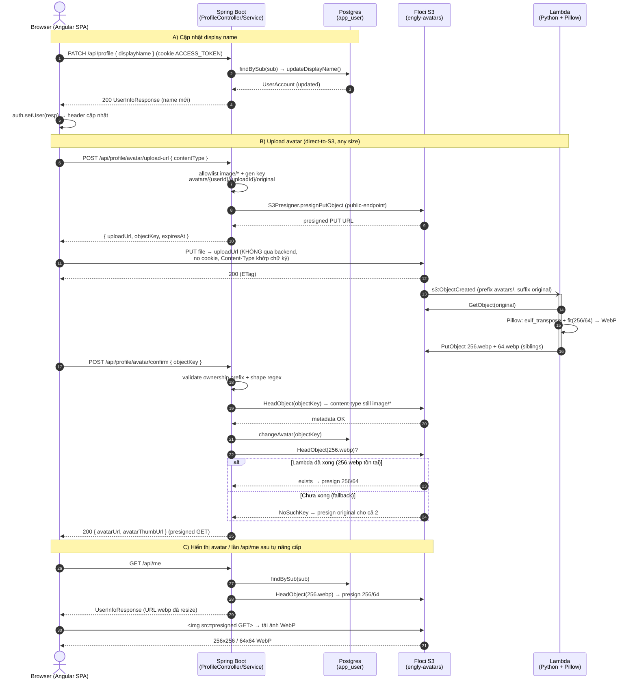

# Sequence Diagram — Profile Update + Avatar Upload (S3 presigned PUT + Lambda resize)

Luồng đầy đủ: (A) cập nhật display name, (B) upload avatar direct-to-S3 + Lambda resize, (C) hiển thị.

## Điểm mấu chốt

- **Bước 8 (PUT file):** browser → S3 trực tiếp, không qua Spring → đúng nghĩa *any size*, không đụng
  giới hạn multipart/nginx/pod memory.
- **Endpoint split:** presign dùng `S3_PUBLIC_ENDPOINT` (`localhost:4566`, browser hit được);
  HeadObject của backend dùng `S3_ENDPOINT` (`host.orb.internal:4566` trong pod). Chữ ký presigned
  gắn với host nên phải tách — giống precedent OIDC `authorization-uri` vs `token-uri`.
- **`alt` ở confirm & /api/me:** graceful degradation — Lambda chưa resize xong thì serve ảnh gốc,
  lần `/api/me` sau tự nâng cấp lên `256.webp` (1 HeadObject, không polling, Lambda không ghi DB).
- **Chống recursion:** derived key (`256.webp`, `64.webp`) không kết thúc bằng `original` → S3
  notification (suffix `original`) không tự trigger lại Lambda.

## Security checkpoints (trên diagram)

| Bước | Kiểm tra |
|------|----------|
| upload-url | content-type allowlist; key do backend sinh (client không chọn) |
| PUT S3 | Content-Type ký sẵn trong URL → S3 từ chối nếu sai |
| confirm | ownership prefix `avatars/{userId}/` + shape regex + HeadObject existence + content-type còn là image/* |
| tất cả | `/api/profile/**` yêu cầu authenticated (cookie JWT) |
